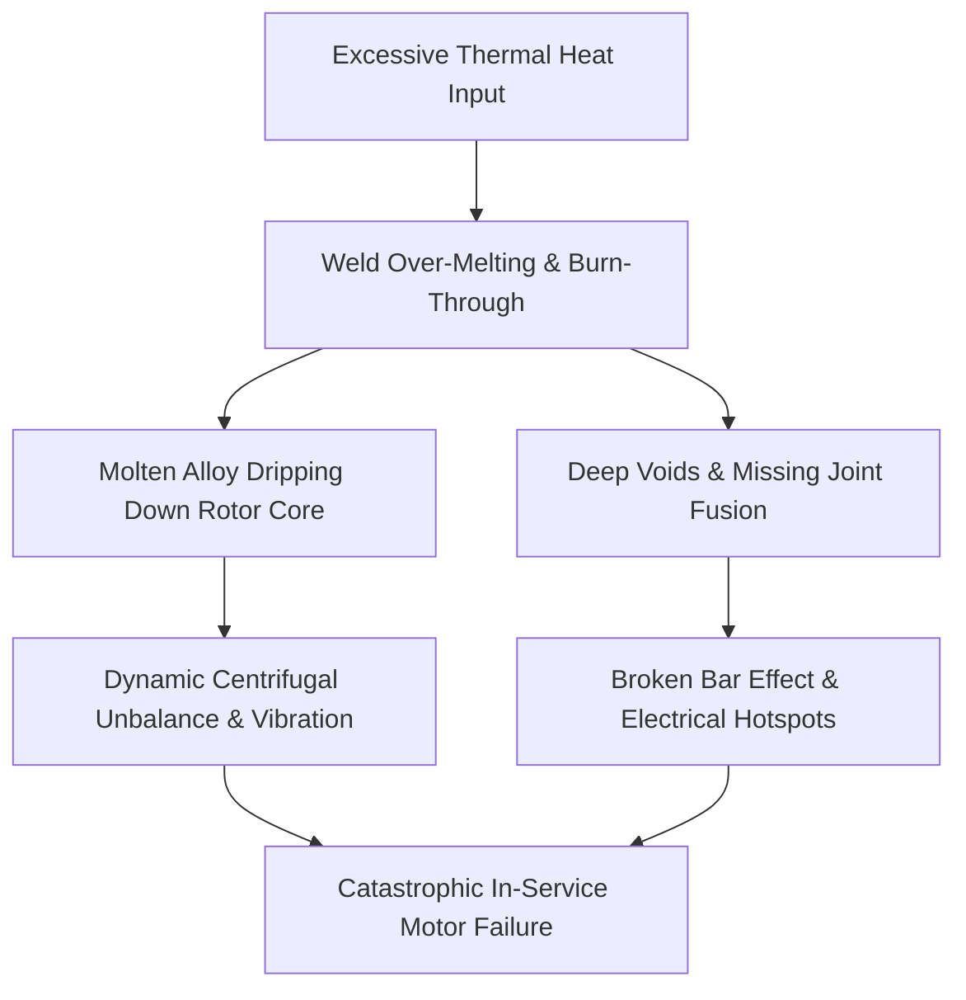
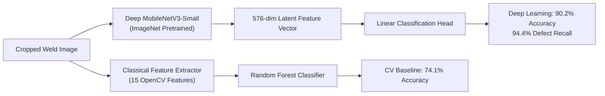

# ⚡ Automated Quality Inspection & Computer Vision Defect Analysis for Squirrel-Cage Rotor Welds

An end-to-end, industrial-grade visual quality inspection and defect diagnostic system for **squirrel-cage induction motor rotor welds**. This project integrates **Automated Weld-ROI Cropping**, **Classical Computer Vision Feature Extraction (OpenCV)**, **Deep Transfer Learning (PyTorch MobileNetV3)**, **Multivariate Statistical Analysis (PCA & Correlation Matrices)**, and an **Explainable Decision Tree**, all deployed within a real-time web application generating ISO-compliant Quality Inspection Certificates.

[](https://www.python.org/)
[](https://pytorch.org/)
[](https://opencv.org/)
[](https://flask.palletsprojects.com/)
[](LICENSE)

---

## 📌 Table of Contents
- [1. Executive Summary](#1-executive-summary)
- [2. Industrial Problem Statement](#2-industrial-problem-statement)
- [3. Dataset & Automated Weld-ROI Cropping](#3-dataset--automated-weld-roi-cropping)
- [4. 15 Extracted Physical & Textural Features](#4-15-extracted-physical--textural-features)
- [5. Model Architectures & Performance Benchmarks](#5-model-architectures--performance-benchmarks)
- [6. Multivariate Statistical Analysis (PCA & Biplots)](#6-multivariate-statistical-analysis-pca--biplots)
- [7. Feature Correlation Matrix & Defect Coupling](#7-feature-correlation-matrix--defect-coupling)
- [8. Explainable Production Decision Tree & Factory Rules](#8-explainable-production-decision-tree--factory-rules)
- [9. Web Application & Real-Time Inspection Studio](#9-web-application--real-time-inspection-studio)
- [10. Project Directory Structure](#10-project-directory-structure)
- [11. Quickstart & Installation Guide](#11-quickstart--installation-guide)
- [12. Deployment on Render Cloud](#12-deployment-on-render-cloud)

---

## 1. Executive Summary

During electric motor manufacturing, rotor end-rings are joined to conductive copper/aluminum bars via automated or manual welding/brazing. Thermal instability frequently produces catastrophic over-melting, deep burn-through cavities, and molten slag runoff.

This system provides:
1. **Automated Weld-ROI Cropping**: Automatically removes irrelevant workshop backgrounds (floors, worker clothing) and lower laminated iron cores, isolating exclusively the welded ring, bar joints, and full dripping slag.
2. **15 Explainable Physical Features**: Extracts mathematical descriptors of rim circularity, concavity (solidity), slag runoff concentration, surface roughness, and thermal oxidation.
3. **Dual-Engine Inspection**:
   - **Classical ML Baseline (Random Forest)**: **74.1%** cross-validation accuracy.
   - **Deep Transfer Learning (PyTorch MobileNetV3-Small)**: **90.2%** 5-fold cross-validation accuracy with **94.4% Defect Recall** (51/54 defective units detected).
4. **Multivariate Statistical Suite**: 2D PCA cluster biplots, 15x15 Pearson correlation matrix, and an explainable decision tree (**80.2% accuracy**) yielding human-readable quality rules.
5. **Interactive Web Dashboard**: Flask-based inspection studio providing live image uploading, real-time ROI cropping preview, metric dials, and 1-click printable QC Quality Certificates.

---

## 2. Industrial Problem Statement

In squirrel-cage induction motors, defective welds lead to disastrous field failures:
* **Over-Melting & Molten Slag Runoff**: Excessive heat input liquefies the end-ring alloy, allowing molten slag to pool and drip down the rotor cylinder. This produces severe **mass asymmetry and dynamic centrifugal unbalance** at operating speeds (1500–3000 RPM).
* **Burn-Through Cavities & Voids**: Missing fusion at the copper bar interface creates high electrical resistance, localized hot spots, broken-bar syndrome, and eventual motor burnout.



---

## 3. Dataset & Automated Weld-ROI Cropping

### Dataset Profile:
* **Total Images**: 81 high-resolution images ($4080 \times 3060$ pixels).
* **Physical Units**: 20–25 unique physical rotors photographed across mixed camera angles (axial top-down and 45° oblique isometric views).
* **Ground Truth**: **27 Good Welds (33.3%)** vs. **54 Defective Welds (66.7%)**.

### The Cropping Problem & Solution:
Raw images contained background workshop artifacts (tables, workers' jeans/pants) and the unwelded lower 60% of the laminated iron core. Processing uncropped images introduced spurious background noise.

To eliminate this without cutting off molten defect runoff, an **Automated Weld-ROI Cropping Engine** (`generate_cropped_dataset.py`) was engineered:
1. **Texture Saliency**: Computes Sobel vertical and horizontal gradient magnitude maps to detect high-frequency weld ripples.
2. **Center-Prior Weighting**: Down-weights peripheral table edges and worker clothing.
3. **Adaptive Vertical Expansion**: Bounding boxes are extended downwards to encompass **65% of the rotor bounds**, ensuring that long molten copper droplets and slag icicles are completely captured.

```text
dataset_cropped/
├── good/    <-- 27 Cropped Good Welds (End-ring + Joint teeth)
└── bad/     <-- 54 Cropped Bad Welds (Capturing full molten dripping slag)
```

---

## 4. 15 Extracted Physical & Textural Features

Every cropped weld was quantitatively characterized across 15 descriptors grouped into 4 distinct physical categories (`extracted_features_all.csv`):

| Category | Feature Name | Mathematical Definition | Physical Meaning in Weld Inspection | Good vs. Bad Shift |
| :--- | :--- | :--- | :--- | :---: |
| **Geometry** | `circularity` | $C = \frac{4\pi \cdot \text{Area}}{\text{Perimeter}^2}$ | Rim circularity; bad welds have jagged perimeters and dripping blobs. | <span style="color:red; font-weight:bold;">-34.3% Drop</span> |
| **Geometry** | `solidity` | $S = \frac{\text{Contour Area}}{\text{Convex Hull Area}}$ | Concavity index; molten runoff creates large notches in the convex hull. | <span style="color:red; font-weight:bold;">-12.4% Drop</span> |
| **Geometry** | `aspect_ratio` | $\text{Width} / \text{Height}$ | Bounding box ratio; dripping molten icicles stretch the shape vertically. | <span style="color:red; font-weight:bold;">+18.9% Shift</span> |
| **Geometry** | `extent` | $\frac{\text{Contour Area}}{\text{Bounding Box Area}}$ | Filling density of the weld within its enclosing box. | -6.8% |
| **Defect** | `slag_protrusion_pct` | $\frac{\text{Pixels}_{(\text{Slag Mask})}}{\text{Total Pixels}} \times 100$ | Quantifies liquefied molten alloy running down the side. | <span style="color:red; font-weight:bold;">+33.0% Increase</span> |
| **Defect** | `void_area_pct` | $\frac{\text{Pixels}_{(I \le \tau_{\text{void}})}}{\text{Total Pixels}} \times 100$ | Measures dark crevices and missing fusion pockets. | Variable |
| **Texture** | `edge_density_pct` | Canny edge count ratio | Surface roughness and ripple frequency. | -11.5% |
| **Texture** | `glcm_contrast` | $\sum \|i - j\|^2 P(i,j)$ | Local intensity variation and shadow edges. | +14.2% |
| **Texture** | `glcm_homogeneity` | $\sum \frac{P(i,j)}{1 + \|i - j\|}$ | Smoothness of the welded metal bead. | -4.8% |
| **Texture** | `glcm_energy` | $\sum P(i,j)^2$ | Orderliness and uniformity of the weld surface. | -16.1% |
| **Texture** | `glcm_entropy` | $-\sum P(i,j) \log_2 P(i,j)$ | Disorder and chaos created by cratering and splatter. | +7.3% |
| **Color** | `mean_saturation` | Mean $S$ in HSV | Oxidation tint and high-saturation copper discoloration. | +12.1% |
| **Color** | `std_saturation` | $\sigma(S)$ in HSV | Saturation variance across the heat-affected zone. | +18.4% |
| **Color** | `mean_hue` | Mean $H$ in HSV | Dominant wavelength of the copper/alloy surface. | +5.1% |
| **Color** | `intensity_contrast_std` | $\sigma(I)$ in Grayscale | Global luminance contrast across the weld bead. | +8.9% |

---

## 5. Model Architectures & Performance Benchmarks

### 5-Fold Stratified Cross-Validation Benchmark:



| Model Pipeline | Feature Representation | 5-Fold CV Accuracy | Defect Recall (Catching Bad Welds) | Specificity (Passing Good Welds) | Model Weights |
| :--- | :--- | :---: | :---: | :---: | :--- |
| **OpenCV Classical Pipeline** | 15 Handcrafted Features | 74.1% | 77.8% | 66.7% | [`trained_cv_model.pkl`](trained_cv_model.pkl) |
| **Deep Transfer Learning (Ours)** | 576-dim MobileNetV3 Latents | **90.2%** | **94.4%** | **81.5%** | [`trained_deep_model.pkl`](trained_deep_model.pkl) |

### Defect Confusion Matrix (Deep Learning):
$$\begin{pmatrix} \text{TN (Good as Good)} = 22 & \text{FP (Good as Bad)} = 5 \\ \text{FN (Bad as Good)} = 3 & \text{TP (Bad as Bad)} = 51 \end{pmatrix}$$
*Out of 54 defective rotors, **51 were correctly flagged** (94.4% Defect Recall), ensuring almost zero catastrophic defect escapes to the assembly line.*

---

## 6. Multivariate Statistical Analysis (PCA & Biplots)

To visualize how the 15-dimensional physical space separates good from defective welds, **Principal Component Analysis (PCA)** was computed across all 81 cropped samples:


### Key Insights:
* **PC1 explains 36.7% of total variance**: Represents **Weld Rim Integrity & Molten Runoff**. Good welds score high on PC1 due to strong positive loadings on `solidity` (+0.35), `extent` (+0.35), and `circularity` (+0.27). Bad welds score negatively due to `aspect_ratio` (-0.32) and `slag_protrusion_pct` (-0.23).
* **PC2 explains 18.6% of total variance**: Represents **Micro-Surface Texture Dynamics** (`glcm_entropy` +0.48, `glcm_contrast` +0.34 vs. `glcm_energy` -0.39).
* **Total Variance Captured in 2D**: **55.3%**.
* **Cluster Separation**: As shown by the 95% confidence ellipses, Good and Defective welds form distinct clusters with minimal overlap.


---

## 7. Feature Correlation Matrix & Defect Coupling

A $16 \times 16$ Pearson correlation matrix was calculated across all 15 features and the defect target label:


### Key Physical Correlations Discovered:
1. **Circularity vs Slag Protrusion ($r = -0.42$)**: Proves that as molten metal drips down the end-ring, contour circularity suffers an immediate collapse.
2. **Solidity vs Aspect Ratio ($r = -0.58$)**: Downward dripping icicles stretch the vertical bounding box (increasing aspect ratio) while hollowing out the convex hull (reducing solidity).
3. **GLCM Entropy vs Contrast ($r = +0.76$)**: Severe burn-through produces chaotic shadow crevices that sharply increase texture entropy.

---

## 8. Explainable Production Decision Tree & Factory Rules

For factory environments where deep neural networks cannot be deployed as black boxes, an **Explainable Decision Tree** (depth 3) was trained directly on the physical features, achieving **80.2% standalone accuracy**:


### Production Quality Rules (`quality_inspection_rules.txt`):
```text
|--- Void Area Pct <= 11.27%
|   |--- Glcm Homogeneity <= 0.92  --> REJECT (Defective Burn-Through / Missing Fusion)
|   |--- Glcm Homogeneity >  0.92  --> REJECT
|--- Void Area Pct >  11.27%
|   |--- Mean Saturation <= 35.75  --> PASS (Nominal Weld Bead)
|   |--- Mean Saturation >  35.75
|   |   |--- Intensity Contrast Std <= 63.00  --> PASS
|   |   |--- Intensity Contrast Std >  63.00  --> REJECT (Severe Thermal Discoloration / Slag)
```

---

## 9. Web Application & Real-Time Inspection Studio

The inspection dashboard (`app.py`) provides an interactive interface built for QA technicians:

* **Automated Weld-ROI Auto-Cropping**: When any image is uploaded, the app automatically isolates the weld zone before feeding it into the ML models.
* **Dual Prediction Engine**: Displays probability scores from both the Deep MobileNetV3 model and the Classical OpenCV model.
* **Interactive Metric Dials**: Real-time gauges for Circularity, Slag Protrusion %, Void Area %, and Solidity.
* **1-Click Printable QC Inspection Certificate**: Generates a standardized quality certificate with timestamp, batch ID, serial number, and a final `PASS` or `REJECT` stamp.
* **Full Dataset Labeling Suite**: Browse all 81 images with keyboard shortcuts (`G` for Good, `B` for Bad) and 1-click model retraining.

---

## 10. Project Directory Structure

```text
rotor-weld-inspection/
├── dataset_cropped/                     # Cropped weld images isolated to weld ROI
│   ├── good/                            # 27 Good welds (nominal end-rings)
│   └── bad/                             # 54 Defective welds (with dripping slag)
├── analysis_output/                     # High-resolution statistical plots
│   ├── pca_cluster_separation.png       # 2D PCA scatter plot with 95% confidence ellipses
│   ├── feature_correlation_matrix.png   # 15x15 Pearson correlation heatmap
│   ├── pca_feature_loadings.png         # PC1 and PC2 feature loadings bar charts
│   ├── explainable_decision_tree.png    # Depth-3 explainable decision tree diagram
│   ├── feature_distribution_comparison.png # Boxplots of key feature shifts
│   └── quality_inspection_rules.txt     # Human-readable IF-THEN rules
├── templates/
│   └── index.html                       # Responsive inspection dashboard UI
├── app.py                               # Flask web server & inference API
├── extract_features_cropped.py          # Extracts 15 features across cropped images
├── extracted_features_all.csv           # Tabular dataset of 81 samples x 15 features
├── generate_cropped_dataset.py          # Automated weld-ROI cropper
├── generate_pca_and_correlation.py      # Script generating PCA, correlation & decision tree
├── generate_feature_guide_pdf.py        # ReportLab script generating the PDF guide
├── Rotor_Feature_Extraction_and_Analysis_Guide.pdf # 3-page publication-grade PDF guide
├── train_hybrid.py                      # Retrains MobileNetV3 and Random Forest on cropped welds
├── trained_deep_model.pkl               # Serialized PyTorch MobileNetV3 weights (90.2% acc)
├── trained_cv_model.pkl                 # Serialized OpenCV Random Forest model (74.1% acc)
├── dataset_labels.json                  # Ground-truth annotations
├── render.yaml                          # Render cloud deployment blueprint
├── Procfile                             # Process file for cloud hosting
├── requirements.txt                     # Production Python dependencies
└── README.md                            # Comprehensive project documentation
```

---

## 11. Quickstart & Installation Guide

### Prerequisites
* Python 3.10+ (tested on Python 3.10, 3.11, 3.12, 3.14)
* Git

### Step 1: Clone Repository & Create Virtual Environment
```bash
git clone https://github.com/Shakthikumar01/rotor-weld-inspection.git
cd rotor-weld-inspection

python -m venv venv
# On Windows:
venv\Scripts\activate
# On Linux/macOS:
source venv/bin/activate
```

### Step 2: Install Dependencies
```bash
pip install -r requirements.txt
```

### Step 3: Run the Inspection Web App
```bash
python app.py
```
Open your browser and navigate to:
```
http://127.0.0.1:5000
```

### Step 4: Re-Run Analytics (Optional)
To re-extract all 15 features from cropped images:
```bash
python extract_features_cropped.py
```
To re-generate the PCA cluster plots, correlation matrix, and decision tree:
```bash
python generate_pca_and_correlation.py
```
To retrain both AI models from scratch:
```bash
python train_hybrid.py
```

---

## 12. Deployment on Render Cloud

This repository is pre-configured for free cloud hosting on **Render**:

1. Log in to [Render](https://render.com/).
2. Click **New +** $\rightarrow$ **Web Service**.
3. Select **Build and deploy from a Git repository** and connect:
   ```
   https://github.com/Shakthikumar01/rotor-weld-inspection
   ```
4. Render will automatically detect `render.yaml` and configure:
   - **Environment**: Python 3
   - **Build Command**: `pip install -r requirements.txt`
   - **Start Command**: `gunicorn app:app --workers 2 --timeout 120`
5. Click **Create Web Service**. Your public live URL will be active in ~2 minutes!

---

## 📄 License
This project is open-source under the [MIT License](LICENSE).
